<div class="filament-hidden">

<p align="center">
  <picture>
    <source media="(prefers-color-scheme: dark)" srcset="https://raw.githubusercontent.com/templix-pro/filament-hush-docs/main/art/dashboard-dark.jpg">
    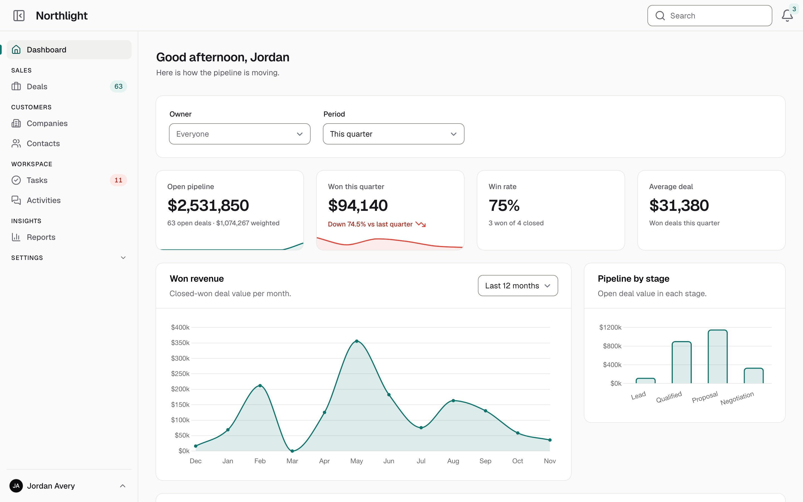
  </picture>
</p>

<h1 align="center">Hush</h1>

<p align="center">
  <strong>A quiet, precise theme for Filament panels.</strong><br>
  Three layouts, six accents, three backgrounds, three dark shades, a per-user Appearance menu, a branded sign-in and Lucide icons, in one plugin.
</p>

<p align="center">
  <a href="#requirements"></a>
  <a href="#requirements"></a>
  <a href="#requirements"></a>
  <a href="#use-your-own-tailwind-theme"></a>
  <a href="https://github.com/templix-pro/filament-hush-docs/blob/main/LICENSE.md"></a>
</p>

> This repository holds the public documentation of Hush. The plugin itself is commercial and is installed with Composer from its private repository once you have a license.

</div>

Hush restyles every part of a Filament panel (navigation, tables, forms, actions, modals, widgets, notifications and the auth pages) with calm neutrals, hairline borders, Geist type and a single accent color. It works the moment you register the plugin, with no build step, and it can also be imported into your own Tailwind theme.

**Live demo:** [northlight-demo.on-forge.com](https://northlight-demo.on-forge.com). The sign-in form is filled in for you, and the data resets every hour.

<div class="filament-hidden">

## Contents

- [Features](#features)
- [Requirements](#requirements)
- [Installation](#installation)
- [Configuration](#configuration)
- [Per-user appearance](#per-user-appearance)
- [Branded sign-in](#branded-sign-in)
- [Lucide icons](#lucide-icons)
- [Use your own Tailwind theme](#use-your-own-tailwind-theme)
- [Screenshots](#screenshots)
- [Updating](#updating)
- [Support](#support)
- [Credits](#credits)
- [License](#license)

</div>

## Features

- **Three layouts.** *Classic* puts a top bar across the page. *Inset* sets the content on a rounded sheet inside a tinted frame. *Sidebar* drops the top bar and gives the content the full height of the window.
- **Six accents, or any color.** Teal, Indigo, Violet, Rose, Amber and Graphite, or pass a hex, rgb or oklch color, or any Filament palette. Neutrals and status colors stay tuned to Hush.
- **Density and corners.** A comfortable or compact rhythm for data-heavy panels, and sharp, default or rounded corners.
- **Three backgrounds.** *Soft* keeps the page, the sidebar and the top bar on one tone. *Tinted* sets the sidebar and the top bar a step deeper than the page. *Bright* lifts the sidebar and the top bar to the white of the cards. The page never takes the cards' color, so cards and tables always stand out. Each works in light mode and in every dark shade.
- **Three dark shades.** The default dark, a softer *Dim* gray, and pure *Black* for OLED screens.
- **Per-user Appearance menu.** An optional item in the user menu lets each person choose their own accent, density, corners, layout, background and dark shade. Choices are kept in a cookie or on the user record.
- **Branded sign-in.** A brand panel with your logo, a heading and a description beside the sign-in, registration, password reset and two-factor pages.
- **Lucide icons.** One call swaps 217 of Filament's own icons for Lucide, and the full Lucide set (2,356 icons) ships with the plugin for your navigation and actions.
- **Collapsed brand mark.** When the sidebar collapses in the Sidebar layout, your logo gives way to a compact mark.
- **Subtle motion.** A soft page entrance, gentler toasts and shimmering loading skeletons, all of which turn off automatically when the system asks for reduced motion.
- **Print styles.** Pages print in light mode without navigation, actions, filters or pagination.
- **Careful details.** RTL-aware, contrast of text and controls covered by tests in every theme, and container-query stat cards whose values never overflow.

## Requirements

| | Version |
| --- | --- |
| PHP | 8.3 or newer |
| Laravel | 12 or 13 |
| Filament | 5.x |

## Installation

Hush is a paid plugin, installed with Composer from its private repository. Buy a license on the [Hush page of the Filament plugin directory](https://filamentphp.com/plugins/lauro-guedes-hush), then use the email address and license key from your purchase receipt: the email is the username and the license key is the password.

**1. Add the repository and your credentials**

```bash
composer config repositories.hush composer https://filament-hush-theme.composer.sh
composer config http-basic.filament-hush-theme.composer.sh "you@example.com" "your-license-key"
```

The second command saves your credentials in `auth.json`. Keep that file out of version control, and give your CI and servers the same credentials through their own `auth.json` or the `COMPOSER_AUTH` environment variable.

**2. Require the package**

```bash
composer require templix-pro/filament-hush
```

**3. Register the plugin on your panel**

```php
use TemplixPro\FilamentHush\HushPlugin;

public function panel(Panel $panel): Panel
{
    return $panel
        // ...
        ->plugin(HushPlugin::make());
}
```

**4. Publish the stylesheet**

```bash
php artisan filament:assets
```

That's it. Hush registers a precompiled stylesheet, its colors, Geist and Geist Mono, and its layout sizes on the panel.

## Configuration

Every option is a method on the plugin. Each accepts an enum or its string value, so `->layout(HushLayout::Inset)` and `->layout('inset')` are the same.

```php
use Filament\Support\Colors\Color;
use TemplixPro\FilamentHush\HushAccent;
use TemplixPro\FilamentHush\HushBackground;
use TemplixPro\FilamentHush\HushDarkVariant;
use TemplixPro\FilamentHush\HushDensity;
use TemplixPro\FilamentHush\HushIconSet;
use TemplixPro\FilamentHush\HushLayout;
use TemplixPro\FilamentHush\HushPlugin;
use TemplixPro\FilamentHush\HushRadius;

HushPlugin::make()
    ->layout(HushLayout::Inset)
    ->accent(HushAccent::Indigo)        // or '#4f46e5', or Color::Sky
    ->density(HushDensity::Compact)
    ->radius(HushRadius::Rounded)
    ->background(HushBackground::Tinted)
    ->darkVariant(HushDarkVariant::Dim)
    ->iconSet(HushIconSet::Lucide)
    ->userAppearance();
```

| Method | Values | Default |
| --- | --- | --- |
| `layout()` | `Classic`, `Inset`, `Sidebar` | `Classic` |
| `accent()` | `Teal`, `Indigo`, `Violet`, `Rose`, `Amber`, `Graphite`, a color string or a Filament palette | `Teal` |
| `density()` | `Comfortable`, `Compact` | `Comfortable` |
| `radius()` | `Sharp`, `Default`, `Rounded` | `Default` |
| `background()` | `Soft`, `Tinted`, `Bright` | `Soft` |
| `darkVariant()` | `Default`, `Dim`, `Black` | `Default` |
| `iconSet()` | `Heroicons`, `Lucide` | `Heroicons` |
| `userAppearance()` | `true`, or a list of `accent`, `density`, `radius`, `layout`, `background`, `darkVariant` | off |
| `storeAppearanceUsing()` | `CookieAppearanceStore`, `UserAttributeAppearanceStore` or your own `AppearanceStore` | cookie |
| `splitAuth()` | a heading, a description and an optional condition | off |
| `brandMark()` | an image URL, an `Htmlable` such as an inline SVG, or a closure | the brand's initial |
| `withoutBrandMark()` | | |
| `withoutFonts()` | keeps your panel's fonts instead of Geist | Geist and Geist Mono |
| `withoutAnimations()` | turns off Hush's motion | on |
| `nativeSelects()` | brings back the browser's `<select>` | Filament's dropdown |
| `withoutPrecompiledTheme()` | for panels that import Hush into their own theme | precompiled theme |

Filament's installer adds `->colors(['primary' => Color::Amber])` to new panels. Registered before the plugin, as it is by default, it gives way to Hush's accent; to keep a color of your own, pass it to `accent()`. Colors registered after the plugin still win.

### Collapsed brand mark

In the `Sidebar` layout, with `->sidebarCollapsibleOnDesktop()` on the panel, a compact mark takes the logo's place while the sidebar is collapsed. It is the brand's initial by default:

```php
HushPlugin::make()
    ->layout(HushLayout::Sidebar)
    ->brandMark(asset('images/mark.svg'));   // or new HtmlString('<svg>…</svg>'), or ->withoutBrandMark()
```

## Per-user appearance

`userAppearance()` adds an **Appearance** item to the user menu. Each person can then override the panel's defaults for themselves, and **Reset** returns them to yours. Limit the choices by passing the options you allow:

```php
HushPlugin::make()->userAppearance(['accent', 'density', 'darkVariant']);
```

<p align="center">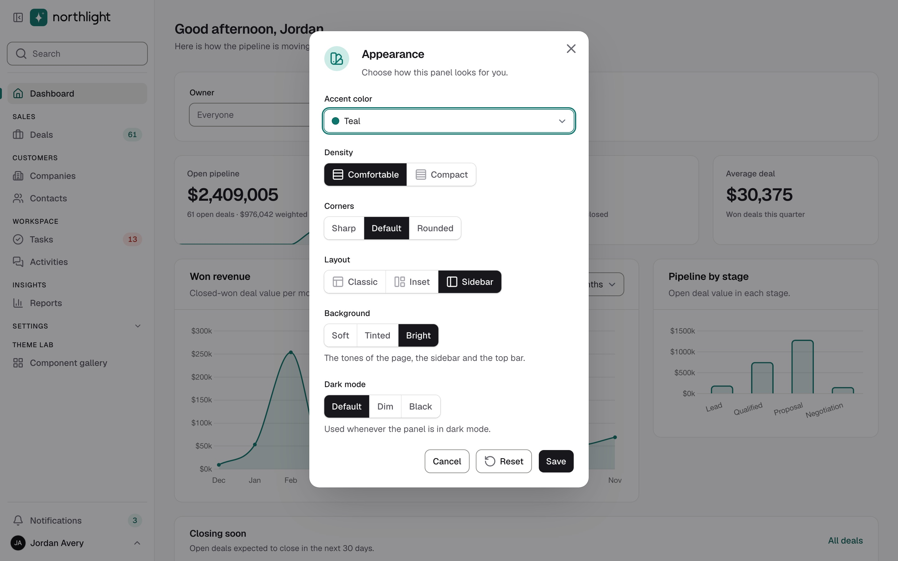</p>

Choices are stored in a cookie by default, so they follow the browser. To keep them on the account instead, so they follow the person to every device, add a JSON column to your users table:

```php
Schema::table('users', function (Blueprint $table) {
    $table->json('hush_appearance')->nullable();
});
```

Cast it on the model:

```php
protected function casts(): array
{
    return [
        // ...
        'hush_appearance' => 'array',
    ];
}
```

Then tell Hush to use it:

```php
use TemplixPro\FilamentHush\Appearance\UserAttributeAppearanceStore;

HushPlugin::make()
    ->userAppearance()
    ->storeAppearanceUsing(new UserAttributeAppearanceStore);   // or new UserAttributeAppearanceStore('appearance')
```

Anything else (a settings table, a team preference) can implement `TemplixPro\FilamentHush\Appearance\AppearanceStore`, which has two methods: `get(?Authenticatable $user): array` and `put(?Authenticatable $user, array $appearance): void`.

## Branded sign-in

`splitAuth()` gives the sign-in page and the other auth pages a brand panel beside the form on large screens: your panel's logo, with an optional heading and description. Small screens keep the form on its own.

```php
HushPlugin::make()->splitAuth(
    heading: 'Every deal, quietly in order.',
    description: 'Pipeline, accounts and follow-ups for the sales team, in one calm place.',
);
```

<p align="center">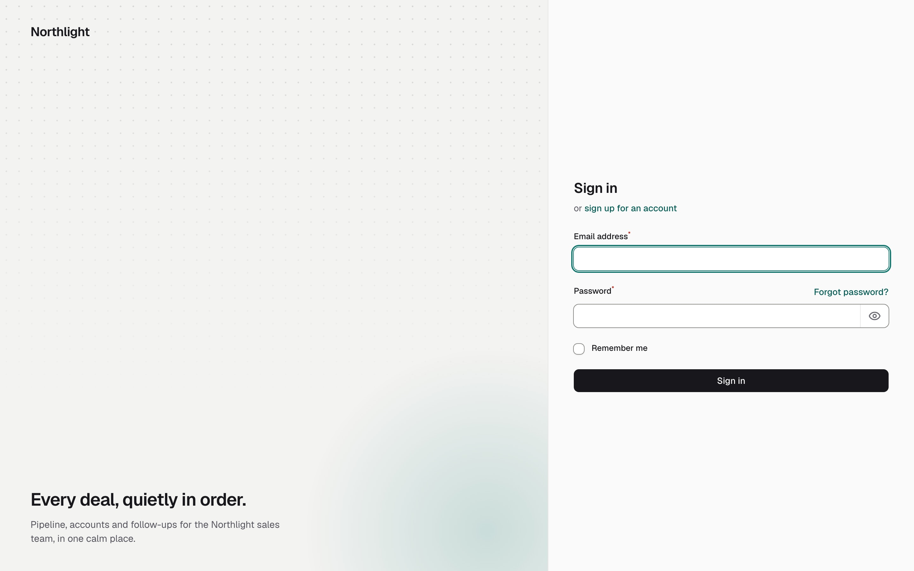</p>

It styles everything Filament's auth offers, including registration, password reset, email verification and the two-factor challenge.

## Lucide icons

```php
HushPlugin::make()->iconSet(HushIconSet::Lucide);
```

This swaps the icons Filament draws in its own interface (buttons, modals, tables, filters, pagination, breadcrumbs, notifications, the sidebar, the rich editor toolbar and more) for their Lucide counterparts. Hush's own Appearance menu follows the same set.

Your application's icons stay as you wrote them. For a consistent look, use the bundled Lucide icons as `hush-lucide.{name}`, with any name from [lucide.dev/icons](https://lucide.dev/icons):

```php
protected static string|BackedEnum|null $navigationIcon = 'hush-lucide.users';

Action::make('archive')->icon('hush-lucide.archive');
```

Hush bundles Lucide 1.72.0. Four rich editor table tools have no Lucide equivalent and keep Filament's icon.

## Use your own Tailwind theme

Panels with their own theme (created with `php artisan make:filament-theme`, which also adds the `viteTheme()` call and the Vite input for you) import Hush right after Filament's theme:

```css
/* resources/css/filament/admin/theme.css */
@import '../../../../vendor/filament/filament/resources/css/theme.css';
@import '../../../../vendor/templix-pro/filament-hush/resources/css/hush.css';

@source '../../../../app/Filament/**/*';
@source '../../../../resources/views/filament/**/*';
```

Then tell Hush to skip its precompiled stylesheet, and build:

```php
$panel
    ->viteTheme('resources/css/filament/admin/theme.css')
    ->plugin(HushPlugin::make()->withoutPrecompiledTheme());
```

```bash
npm run build
```

Hush's tokens are CSS custom properties (`--hush-canvas`, `--hush-surface`, `--hush-line`, `--hush-ink` and friends), so you can adjust them in your theme after the import.

## Screenshots

The screenshots show Northlight, a demo CRM used to develop Hush, which you can [try live](https://northlight-demo.on-forge.com). It is not part of the package.

| Classic | Inset |
| --- | --- |
| 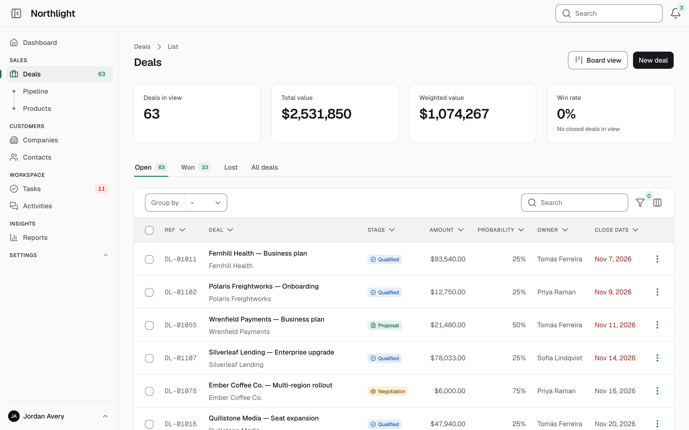 | 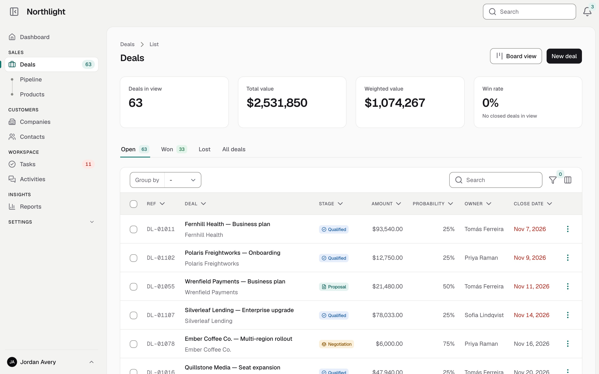 |
| **Sidebar** | **Compact, Violet, sharp corners** |
| 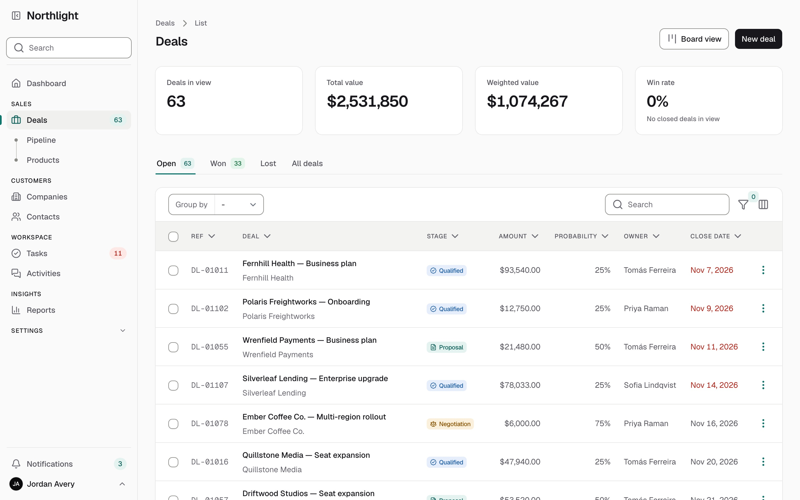 | 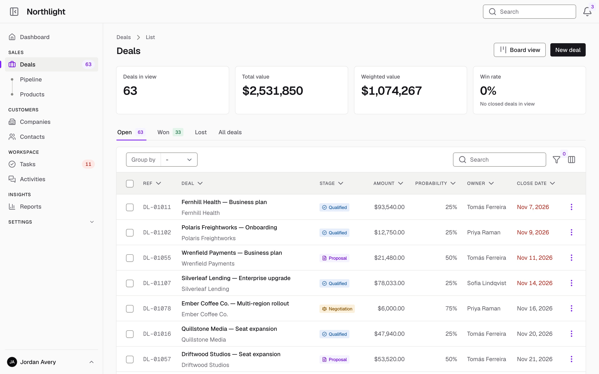 |
| **Dark** | **Dim** |
| 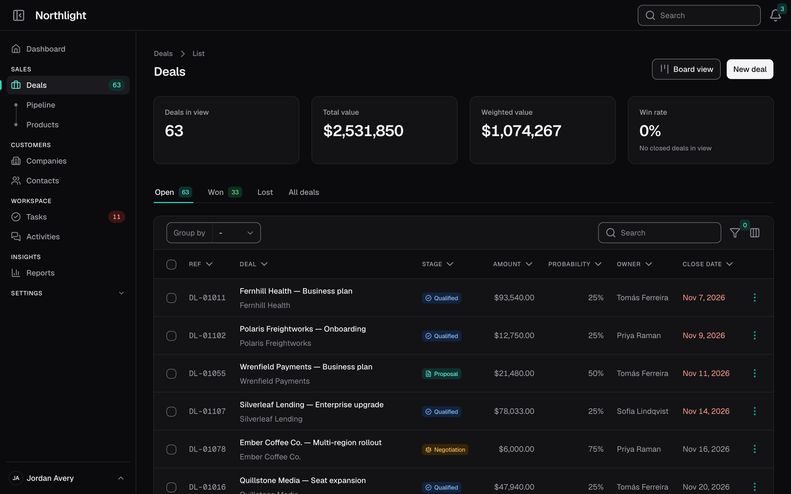 | 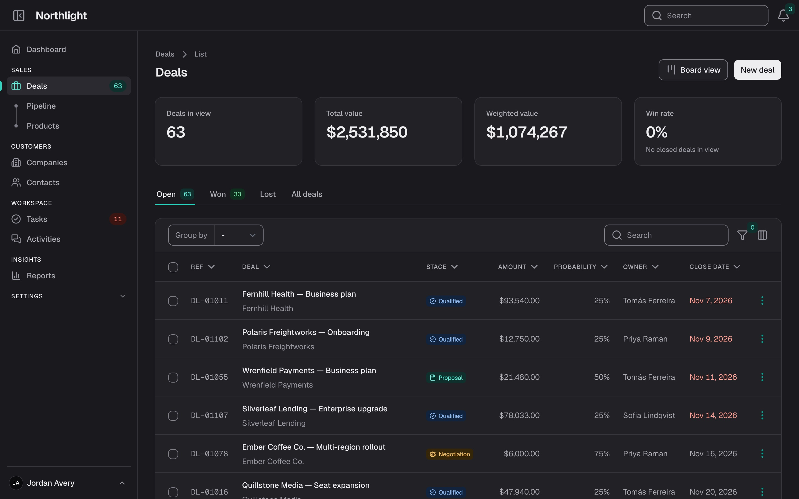 |
| **Black** | **Sign-in in dark mode** |
| 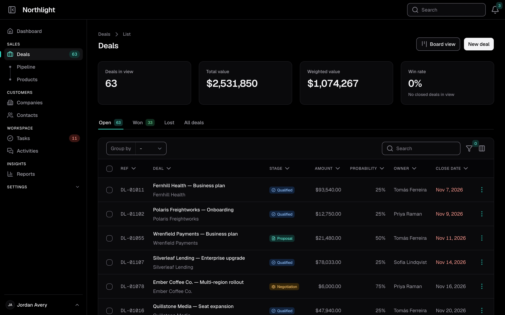 | 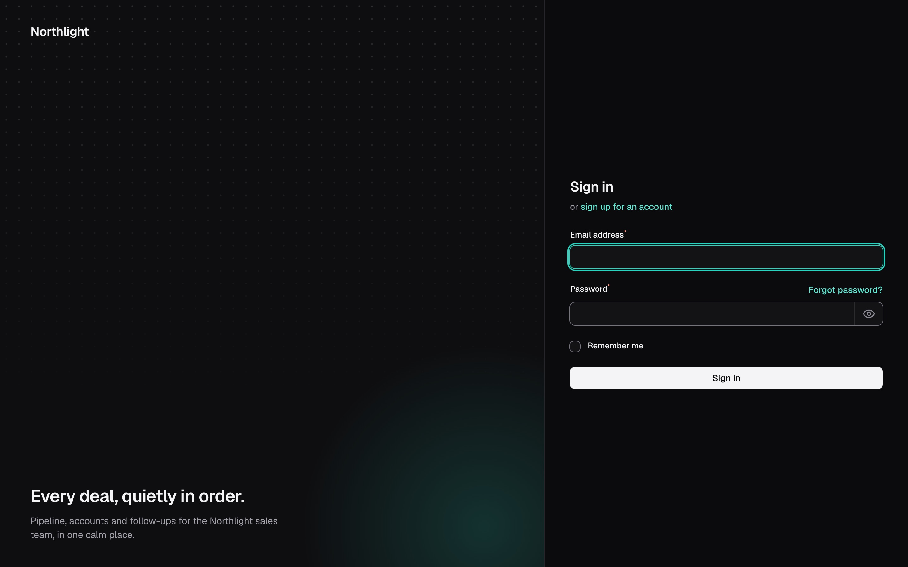 |
| **A custom page (Inset)** | **Dashboard in dark mode** |
| 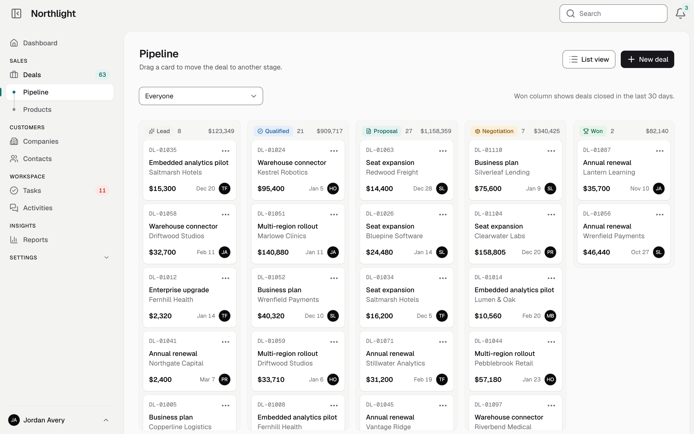 | 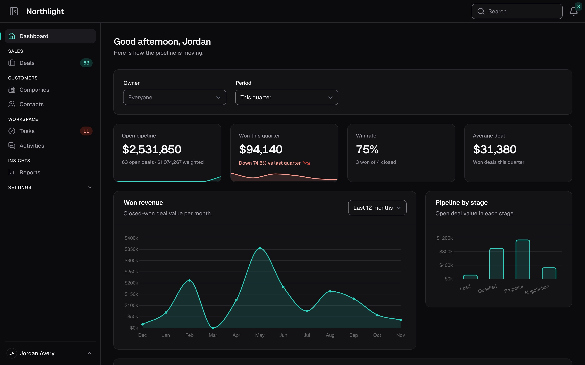 |

On a phone, the whole panel adapts, in light and dark:

<p align="center">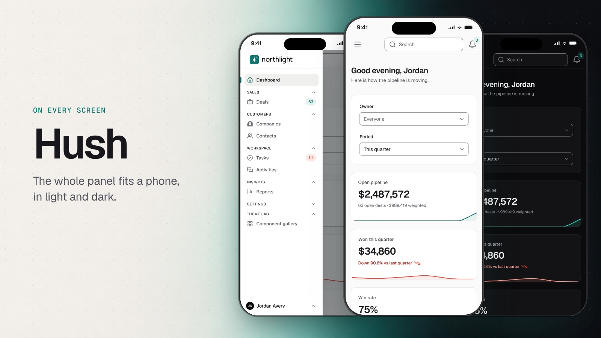</p>

## Updating

```bash
composer update templix-pro/filament-hush
php artisan filament:assets
```

Filament's installer adds `@php artisan filament:upgrade` to your `post-autoload-dump` script, which publishes assets for you. If you use your own theme, run `npm run build` after updating. See the [changelog](https://github.com/templix-pro/filament-hush-docs/blob/main/CHANGELOG.md) for what changed.

Every license includes one year of updates. After that you keep the version you have; renew your license to receive newer releases.

## Support

Support covers Hush as delivered. For questions and bug reports, use the contact details on your purchase receipt and include your Filament, Laravel and PHP versions.

## Credits

- Built by Lauro Guedes for [Filament](https://filamentphp.com).
- Icons from [Lucide](https://lucide.dev) (ISC License).
- Type set in [Geist and Geist Mono](https://vercel.com/font) by Vercel (SIL Open Font License), served by Google Fonts.

See [THIRD-PARTY-NOTICES.md](https://github.com/templix-pro/filament-hush-docs/blob/main/THIRD-PARTY-NOTICES.md) for every bundled component and its license.

## License

Hush is commercial software for business use, sold in two tiers:

- **Single project:** one production project, with unlimited local and staging environments for it.
- **Unlimited projects:** any number of production projects for the business that bought it.

Both include one year of updates and a 30-day refund window. See the [license agreement](https://github.com/templix-pro/filament-hush-docs/blob/main/LICENSE.md) for the full terms.
